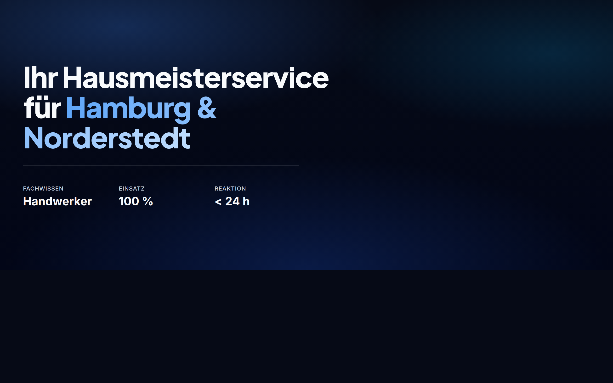
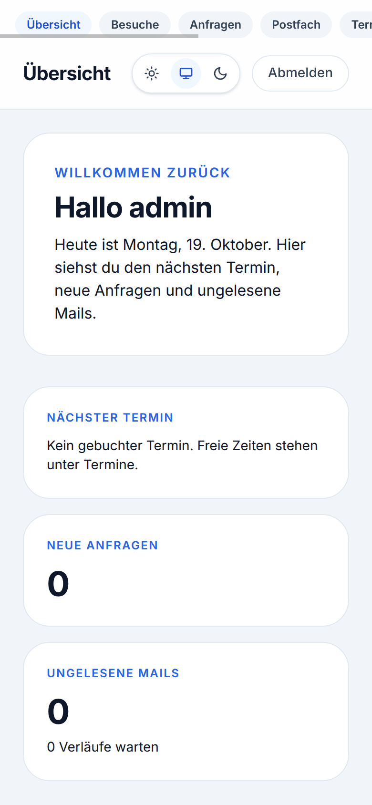
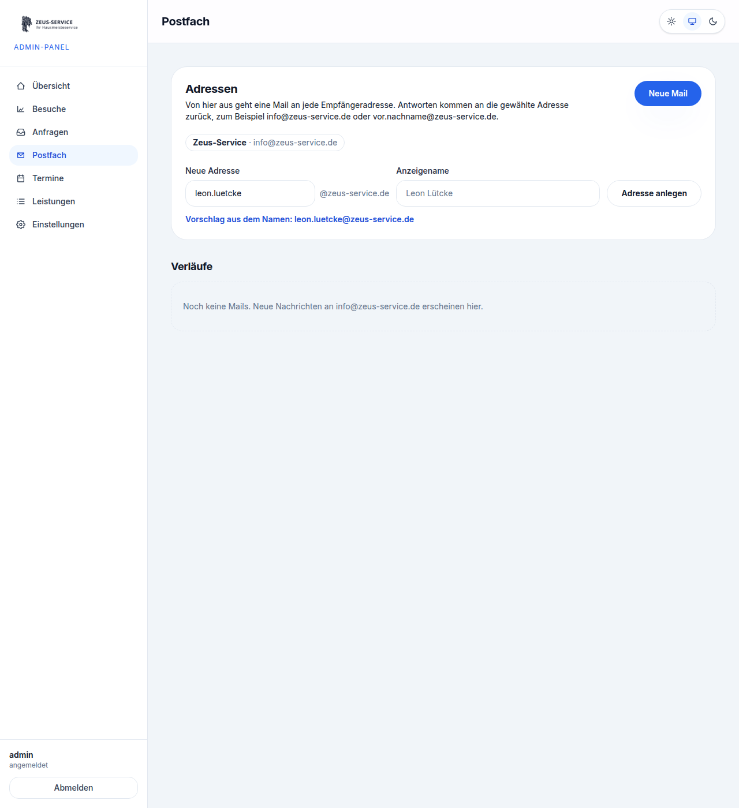
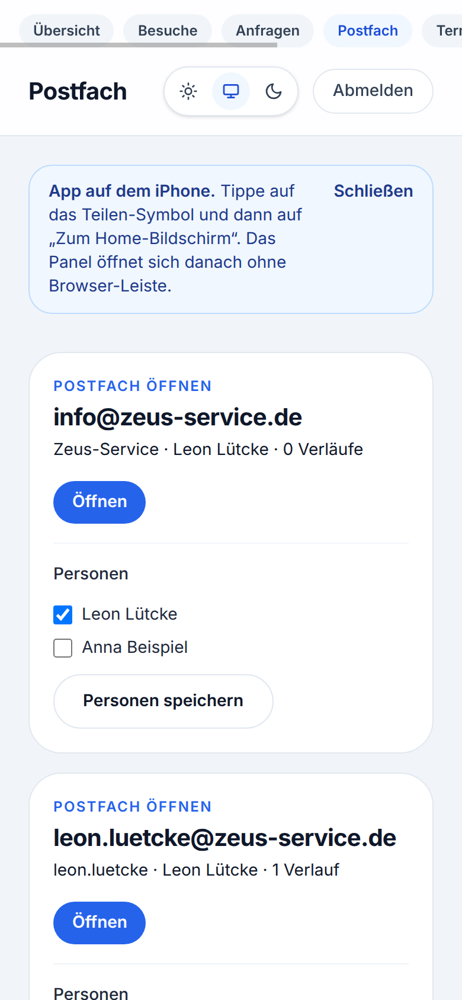
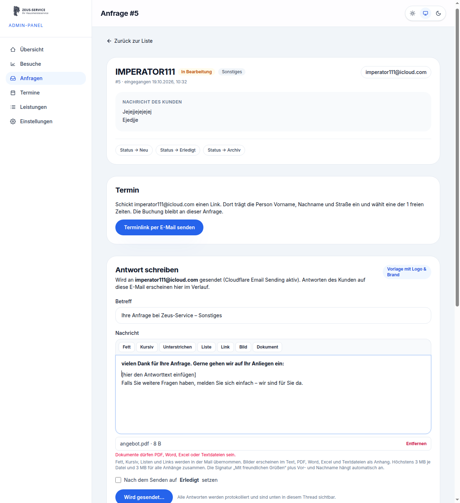
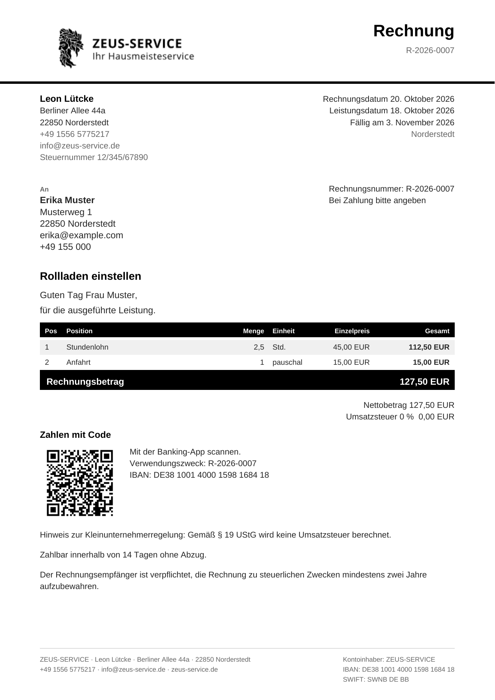
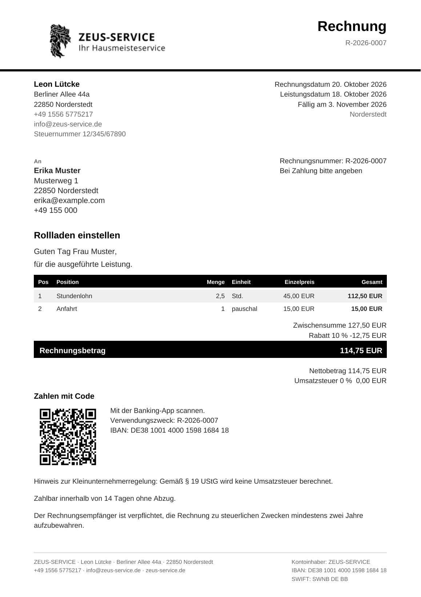
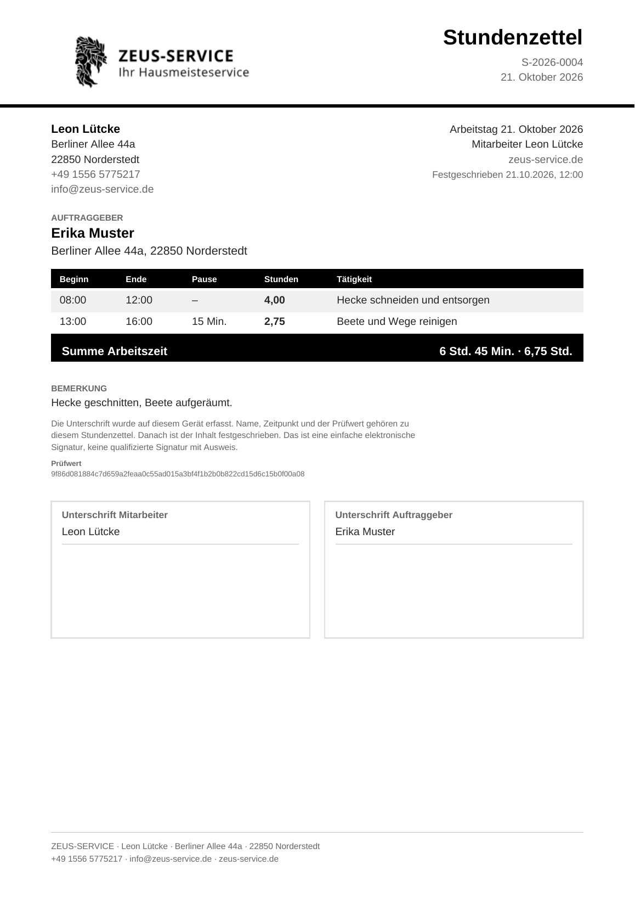
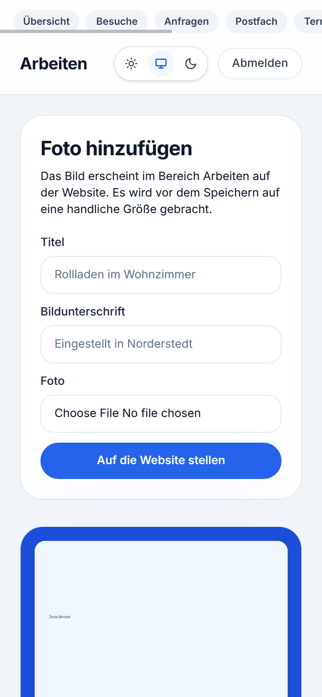

# ZEUS.JS

**ZEUS.JS** ist das Betriebs- und Admin-System hinter [zeus-service.de](https://zeus-service.de/) –
Website, Anfragen, Angebote, Rechnungen, Postfach und Kundenportal in einer Astro-/Cloudflare-App.

Kein klassisches CMS: **ZEUS.JS** ist auf Handwerk & Hausmeisterservice ausgelegt
(Angebot → Auftrag → Rechnung), läuft auf **Cloudflare Workers** und ist mit
**Astro + TypeScript + Tailwind CSS v4** gebaut.



---

## Was ZEUS.JS kann

| Bereich | Funktionen |
|---|---|
| Website | Marketing-Seiten, Dark Mode, Kontaktformular, SEO, Spam-Filter |
| Anfragen | Inbox, Antworten, Anhänge, Termine, Absender sperren |
| Kunden | Kundenakte, Dubletten zusammenführen, Portal-Einladung |
| Buchhaltung | Angebote, Aufträge, Rechnungen (PDF/ZUGFeRD), GiroCode-QR, Rabatt, Mahnung, Stripe, DATEV |
| Team | Postfach, Stundenzettel mit Signatur, Leistungskatalog, Wiederkehrend |

### Eindrücke

**Admin-Übersicht**



**Postfach (Desktop & Mobil)**





**Antwort-Editor**



**Rechnung mit GiroCode & Rabatt**





**Stundenzettel & Arbeiten**





---

## Stack

| Baustein | Wahl |
|---|---|
| Runtime | Cloudflare Workers (`@astrojs/cloudflare`) |
| App | Astro 7 + TypeScript |
| UI | Tailwind CSS v4 |
| Datenbank | Cloudflare D1 (SQLite), Schema in `migrations/` |
| Sessions / Dateien | Cloudflare KV (`SESSIONS`, `FILES`) |
| E-Mail | Cloudflare Email Sending (+ optional Resend) |
| Auth | PBKDF2 + KV-Sessions, Passkeys optional |

---

## ZEUS.JS installieren

Voraussetzungen: **Node.js 22+**, npm, [Cloudflare-Account](https://dash.cloudflare.com/),
optional `CLOUDFLARE_API_TOKEN` mit Rechten für Workers, D1 und KV.

### 1. Repo holen & Abhängigkeiten

```bash
git clone https://github.com/imperator111x/handwerk.git
cd handwerk
npm install
```

### 2. Lokal starten (ohne Cloudflare-Bindings)

```bash
npm run dev
# → http://localhost:4321
```

Für Login lokal in `.dev.vars` (nicht committen):

```bash
ADMIN_PASSWORD_HASH=pbkdf2$210000$…
```

Hash erzeugen: siehe `src/lib/auth.ts` / Setup-Skript unten.

### 3. Cloudflare einrichten (empfohlen: Ein-Befehl)

```bash
export CLOUDFLARE_API_TOKEN='…'
# optional: export CLOUDFLARE_ACCOUNT_ID='…'

bash scripts/setup-cloudflare.sh
```

Das Skript:

1. legt D1 `zeus-service-db` und KV `SESSIONS` an  
2. schreibt Bindings in `wrangler.jsonc`  
3. spielt `migrations/*.sql` remote ein  
4. legt Admin-User an und setzt `ADMIN_PASSWORD_HASH`  
5. baut und deployt **ZEUS.JS**

Nur provisionieren, ohne Deploy:

```bash
bash scripts/setup-cloudflare.sh --skip-deploy
```

### 4. Manuell (kurz)

```bash
npx wrangler login
npx wrangler d1 create zeus-service-db
npx wrangler kv namespace create SESSIONS
# IDs in wrangler.jsonc eintragen

for f in migrations/*.sql; do
  npx wrangler d1 execute zeus-service-db --remote --file="$f"
done

npm run cf:deploy
```

Secrets (Beispiele):

```bash
npx wrangler secret put ADMIN_PASSWORD_HASH
npx wrangler secret put SESSION_SECRET
npx wrangler secret put STRIPE_SECRET_KEY          # optional
npx wrangler secret put STRIPE_WEBHOOK_SECRET      # optional
npx wrangler secret put GOOGLE_PLACES_API_KEY      # optional, Bewertungen
npx wrangler secret put GOOGLE_PLACE_ID            # optional
npx wrangler secret put VIRUSTOTAL_API_KEY         # optional, Anhang-Scan
```

### 5. Domain

Cloudflare Dashboard → **Workers & Pages** → `zeus-service-web` →
*Custom Domains* → z. B. `zeus-service.de` verbinden.

Live-URLs typischerweise:

- Website: `https://zeus-service.de`
- Admin (**ZEUS.JS**): `https://zeus-service.de/admin`
- Kundenportal: `https://zeus-service.de/portal`

---

## Täglich nutzen

1. **Einloggen** unter `/login` (oder Passkey / Face ID auf dem iPhone-Homebildschirm).  
2. **Anfragen** bearbeiten, per Postfach antworten, Termine schicken.  
3. **Kunde** anlegen → **Angebot** → annehmen als **Auftrag** → **Rechnung** (PDF, Mail, Stripe-Link).  
4. Optional: **Stundenzettel** unterschreiben lassen und an die Rechnung hängen.  
5. **Offene Posten**: Erinnerung / Mahnung; **DATEV**-Export unter Buchhaltung.

Mitteilungen (Push): Admin auf dem Home-Bildschirm öffnen → Mitteilungen einschalten.

---

## Entwicklung & Checks

```bash
npm run build
npm run cf:dev          # Wrangler + dist/
npm run check           # Astro/Typecheck
node scripts/test-offer.mjs
node scripts/test-invoice.mjs
node scripts/test-contact-spam.mjs
```

---

## Projektstruktur (Auszug)

```
migrations/           D1-Schema für ZEUS.JS
scripts/              Setup, Tests, Cloudflare-Helfer
docs/screenshots/     UI-Screenshots für diese Doku
src/
  components/         Website- & Admin-UI
  layouts/            Public, Admin, Portal
  lib/                Auth, Angebote, Rechnungen, Postfach, …
  pages/
    admin/            ZEUS.JS Admin-Panel
    portal/           Kundenportal
    api/              Formulare, Webhooks, PDF
  worker.ts           Worker-Entry (Fetch, E-Mail, Cron)
wrangler.jsonc
```

---

## Lizenz / Einsatz

**ZEUS.JS** ist das interne System für Zeus-Service. Deployment und Secrets gehören
zum jeweiligen Cloudflare-Account. Bei Fragen zur Installation: Repo-Issues oder
den Betreiber von zeus-service.de kontaktieren.
